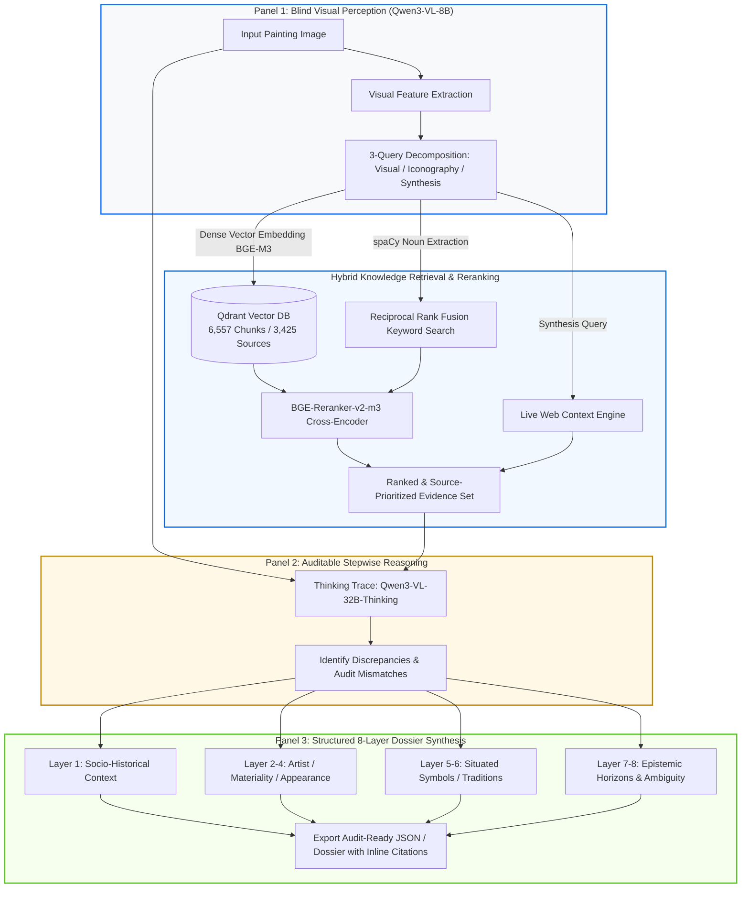

<div align="center">

# ArtDossier 🖼️🔍
### Multimodal RAG Engine for Grounded Cultural Analytics & Visual Interpretation

[](https://www.python.org/)
[](https://qdrant.tech/)
[](https://www.llamaindex.ai/)
[](https://huggingface.co/)
[](LICENSE)

*An end-to-end vision-language pipeline that mitigates multimodal hallucination by decoupling blind visual perception from multi-source hybrid RAG retrieval and citation-grounded reasoning.*

[System Architecture](#-system-architecture) • [Key Features](#-key-features) • [Benchmark Results](#-benchmark--empirical-evaluation) • [Quickstart](#-quickstart) • [Methodology](#-research--methodology)

---

</div>

## 📌 Executive Summary

While contemporary Vision-Language Models (VLMs) can generate fluent surface-level descriptions, they suffer from two critical failure modes in domain-specific workflows: **visual hallucination** and an inability to bridge the **semantic gap** between raw pixels and nuanced contextual knowledge.

**ArtDossier** is a production-grade multimodal retrieval-augmented generation (RAG) framework developed to resolve this bottleneck. Given an unlabelled high-resolution image, the pipeline:
1. **Perceives without metadata bias:** Uses an 8B vision model to extract formal visual descriptors, objects, and iconographic queries *blind* to title and artist.
2. **Retrieves across authoritative corpora:** Executes hybrid vector search (BGE-M3 in Qdrant) + cross-encoder reranking (BGE-Reranker-v2-m3) across 6,557 ingested scholarly chunks (Rijksmuseum, Leiden Collection, Web Gallery of Art) alongside live web search.
3. **Reasoning & synthesis:** Employs a 32B thinking model that treats initial visual captions as a biased prior, audits retrieved evidence in an inspectable trace, and compiles an eight-layer domain dossier with strict inline source attribution.

---

## 🏗️ System Architecture



---

## ⚡ Key Engineering & Design Decisions

- **Inference-Time Metadata Blindness:** Unlike standard RAG setups that query by database ID or known titles, ArtDossier receives *zero* title or metadata prompts. It tests genuine computer-vision-to-text retrieval in zero-shot conditions.
- **Hierarchical Document Authority:** Prompts enforce strict epistemic tiers: Scholarly Catalogues (e.g., Leiden Collection) > Institutional Archives (Rijksmuseum API) > General Web Catalogues (WGA).
- **Inspectable Thinking Trace:** Panel 2 isolates the model's self-critique and alignment logic, preventing black-box confabulation before compiling the final client-facing dossier.
- **Dual Evaluation Regime:** Combines automated NLP metrics (F1, METEOR, BERTScore, CLIPScore) with parallel qualitative evaluations by domain humans and an independent LLM judge (`DeepSeek-V4-Flash`).

## 📊 Empirical Benchmarks & Evaluation

ArtDossier was evaluated across 50 17th-century Dutch paintings (yielding 61 reference-comparison pairs) using both automated NLP/multimodal metrics and parallel qualitative scoring by human review and an independent `DeepSeek-V4-Flash` judge.

### 1. Quantitative NLP & Multimodal Metrics

| Metric | Overall Mean | Leiden Collection (Scholarly) | Rijksmuseum (Institutional) | Web Gallery of Art (Web) | Takeaway |
| :--- | :---: | :---: | :---: | :---: | :--- |
| **BERTScore F1** | **0.79** | 0.81 | 0.77 | 0.79 | Strong semantic alignment across domain vocabularies, even under zero-shot captioning. |
| **CLIPScore** | **72.4** | 69.4 | 73.2 | 75.6 | Validates robust image-text perceptual alignment in Panel 1 blind feature extraction. |
| **Token F1** | **0.145** | 0.272 | 0.060 | 0.117 | Reflects generative synthesis over verbatim reproduction; Leiden's rich prose yielded highest lexical match. |
| **METEOR (x100)** | **17.0** | 25.0 | 7.0 | 14.0 | Captures synonymy and stemming coverage across scholarly references. |

### 2. Retrieval Precision vs. Generation Quality Delta

| Pipeline Condition | Top RAG Chunk Relevancy | Mean BERTScore F1 | AI Judge Score (out of 80) |
| :--- | :---: | :---: | :---: |
| **Title Present in Top-12 Retrieved Chunks (31%)** | > 0.88 | **0.799** | **50.8 / 80** |
| **Title Missed in Retrieval (Thematic Match Only)** | ~ 0.74 | **0.790** | **35.9 / 80** |

> **Key Finding:** While vector rerankers consistently score thematically adjacent artworks high (>0.70 in 84% of cases), exact entity retrieval produces a **~15-point quality jump**. When retrieval misses, parametric knowledge maintains surface fluency but degrades epistemic specificity—highlighting the necessity of inspectable thinking traces.

---

## 🚀 Quickstart & Production Setup

### 1. Environment & Dependencies

```bash
git clone [https://github.com/Wenxuan-Luo11/ArtDossier.git](https://github.com/Wenxuan-Luo11/ArtDossier.git)
cd ArtDossier

# Create virtual environment
python3 -m venv venv
source venv/bin/activate

# Install core pipeline dependencies
pip install -r requirements.txt

# Install evaluation packages
pip install bert-score nltk open-clip-torch torchvision
python -m spacy download en_core_web_sm
```

### 2. Infrastructure Setup (Qdrant Vector DB)

Launch Qdrant using Docker:
```bash
docker run -d -p 6333:6333 -v qdrant_storage:/qdrant/storage qdrant/qdrant
```

Configure your environment credentials:
```bash
cp .env.example .env
# Set SILICONFLOW_API_KEY (or compatible OpenAI endpoint) and QDRANT_HOST=localhost
```

### 3. Ingestion & Indexing Pipeline

```bash
# 1. Normalize schemas across Leiden, Rijksmuseum, and WGA
python corpus/normalize.py

# 2. Chunk documents (512-token boundary-aware split) and embed via BGE-M3
python rag/ingestion/ingest.py

# 3. Create full-text and payload indexes for hybrid search
python setup_qdrant_index.py
```

### 4. Running the Pipeline

**Programmatic API:**
```python
from system.pipeline.pipeline import ArtDossierPipeline

# Initialize orchestrator (default: broad mode)
pipeline = ArtDossierPipeline()

# Run end-to-end analysis on an unlabelled image
result = pipeline.run(image_path="eval_images/sample_painting.jpg")

# Access individual panels
print("=== PANEL 1: BLIND VISION EXTRACTION ===")
print(result.panel1)

print("\n=== PANEL 2: AUDITABLE THINKING TRACE ===")
print(result.panel2_thinking)

print("\n=== PANEL 3: 8-LAYER CRITICAL DOSSIER ===")
print(result.panel3)
```

**Production CLI Batch Execution:**
```bash
# Run broad mode across test suite
python run_batch.py eval_images/broad

# Run expert mode (filters corpus strictly to scholarly/institutional sources)
python run_batch.py eval_images/expert --expert-only
```

---

## 🔎 Sample Output & Citation Audit

<details>
<summary><b>Click to expand: Simulated output for Arent de Gelder, <i>Christ on the Mount of Olives</i> (ca. 1715)</b></summary>

```json
{
  "panel1_perception": "The painting depicts a nocturnal outdoor scene centered on a kneeling figure in luminous drapery, accompanied by a consoling angelic presence with broad feathered wings. In the lower background, several figures lie asleep on sloping terrain...",
  "panel2_reasoning_trace": "Visual evidence indicates 17th/early 18th-century Dutch late-Rembrandt school handling (impasto, warm earth tones, chiaroscuro). Retrieval surfaces candidate catalogues: Leiden Collection (Arent de Gelder), WGA biblical series. Rejecting generic Gethsemane attribution; cross-referencing composition against Leiden Collection entry #AD-1715. Confirmed match based on angel pose and brushwork technique.",
  "panel3_dossier": {
    "layer_1_socio_historical": "Created in Dordrecht during the post-Golden Age transition... [Source: Leiden Collection, essay p. 3, score: 0.92]",
    "layer_2_artist_background": "Arent de Gelder remained committed to Rembrandt's late expressive idiom well into the 18th century... [Source: Leiden Collection, bio, score: 0.89]",
    "layer_3_materiality": "Broad loaded brushwork and wet-in-wet scraping on medium-weave canvas... [Source: Rijksmuseum Technical Bulletin, score: 0.81]",
    "layer_4_appearance": "Tonal composition dominated by yellow ochres and deep umbers...",
    "layer_5_situated_symbols": "The chalice motif adheres to Luke 22:42, treated here not as a physical vessel but as an atmospheric glow...",
    "layer_6_artistic_traditions": "Direct continuation of late-period Rembrandtesque light modeling...",
    "layer_7_epistemic_horizons": "Reconciles Protestant devotional restraint with dynamic compositional energy...",
    "layer_8_ambiguity": "Unresolved tension regarding workshop participation in the background sleeping disciples."
  }
}
```
</details>

---

## 🔬 Research & Theoretical Framework

ArtDossier operationalizes critical aesthetics and digital humanities theory into executable software architecture:
- **Hermeneutical Circle in Code:** Implements Gadamer's interpretative loop—treating Panel 1 as a provisional prior (*fore-understanding*) that is audited, challenged, and refined through external evidence retrieval in Panels 2 and 3 [28].
- **Symptomatic Ambiguity:** Incorporates Didi-Huberman’s critique of epistemic certainty, structuring Layer 8 specifically to surface what remains uncertain, contested, or unresolvable by computational pattern recognition [28].
- **Epistemic Bias Auditing:** Classifies corpus sources into tiered reliability tiers, mitigating the systemic hallucination loops common in crowdsourced or unvetted web catalogues [28].

---

## 📦 Model Stack & Hardware Requirements

| Component | Architecture / Model | Provider / Implementation |
| :--- | :--- | :--- |
| **Vision Perception (P1)** | `Qwen3-VL-8B-Instruct` | SiliconFlow / Hugging Face |
| **Reasoning & Dossier (P2/P3)** | `Qwen3-VL-32B-Thinking` | SiliconFlow / vLLM |
| **Dense Vector Embeddings** | `BAAI/bge-m3` | LlamaIndex / Qdrant (1024-dim) |
| **Cross-Encoder Reranker** | `BAAI/bge-reranker-v2-m3` | Hugging Face Transformers |
| **Independent LLM Judge** | `deepseek-ai/DeepSeek-V4-Flash` | SiliconFlow API |

* **Hardware:** GPU recommended for local ingestion (approx. 60 min on CPU for 6,557 chunks). Inference executes via API or local vLLM instance.

---

## 📜 Citation & License

If you utilize this pipeline, architecture, or benchmark dataset in your work:

```bibtex
@mastersthesis{luo2026artdossier,
  author    = {Wenxuan "Owen" Luo},
  title     = {ArtDossier: Critical Aesthetics and Grounded Multimodal Interpretation of Artworks},
  school    = {University of Amsterdam},
  year      = {2026},
  type      = {Master's Thesis},
  note      = {Faculty of Humanities, Media Studies: Cultural Data \& AI Track}
}
```

Distributed under the **MIT License**. See `LICENSE` for details.
