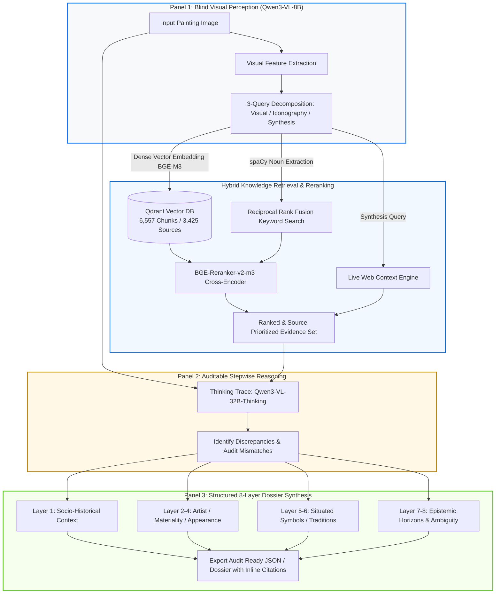

# ArtDossier 🖼️🔍
### Multimodal RAG Engine for Grounded Cultural Analytics & Visual Interpretation

*An end-to-end vision-language pipeline that mitigates multimodal hallucination by decoupling blind visual perception from multi-source hybrid RAG retrieval and citation-grounded reasoning.*

[System Architecture](#-system-architecture) • [Key Features](#-key-features) • [Benchmark Results](#-benchmark--empirical-evaluation) • [Quickstart](#-quickstart) • [Methodology](#-research--methodology)

---

## 📌 Executive Summary

While contemporary Vision-Language Models (VLMs) can generate fluent surface-level descriptions, they suffer from two critical failure modes in domain-specific workflows: **visual hallucination** and an inability to bridge the **semantic gap** between raw pixels and nuanced contextual knowledge.

**ArtDossier** is a production-grade multimodal retrieval-augmented generation (RAG) framework developed to resolve this bottleneck. Given an unlabelled high-resolution image, the pipeline:
1. **Perceives without metadata bias:** Uses an 8B vision model to extract formal visual descriptors, objects, and iconographic queries *blind* to title and artist.
2. **Retrieves across authoritative corpora:** Executes hybrid vector search (BGE-M3 in Qdrant) + cross-encoder reranking (BGE-Reranker-v2-m3) across 6,557 ingested scholarly chunks (Rijksmuseum, Leiden Collection, Web Gallery of Art) alongside live web search.
3. **Reasoning & synthesis:** Employs a 32B thinking model that treats initial visual captions as a biased prior, audits retrieved evidence in an inspectable trace, and compiles an eight-layer domain dossier with strict inline source attribution.

---

## 🏗️ System Architecture

---

## ⚡ Key Engineering & Design Decisions

- **Inference-Time Metadata Blindness:** Unlike standard RAG setups that query by database ID or known titles, ArtDossier receives *zero* title or metadata prompts. It tests genuine computer-vision-to-text retrieval in zero-shot conditions.
- **Hierarchical Document Authority:** Prompts enforce strict epistemic tiers: Scholarly Catalogues (e.g., Leiden Collection) > Institutional Archives (Rijksmuseum API) > General Web Catalogues (WGA).
- **Inspectable Thinking Trace:** Panel 2 isolates the model's self-critique and alignment logic, preventing black-box confabulation before compiling the final client-facing dossier.
- **Dual Evaluation Regime:** Combines automated NLP metrics (F1, METEOR, BERTScore, CLIPScore) with parallel qualitative evaluations by domain humans and an independent LLM judge (`DeepSeek-V4-Flash`).
